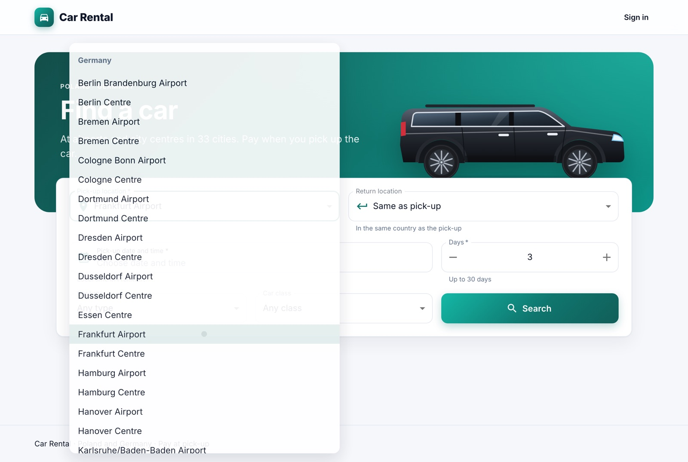
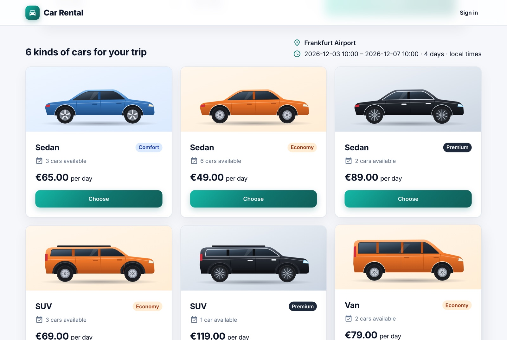
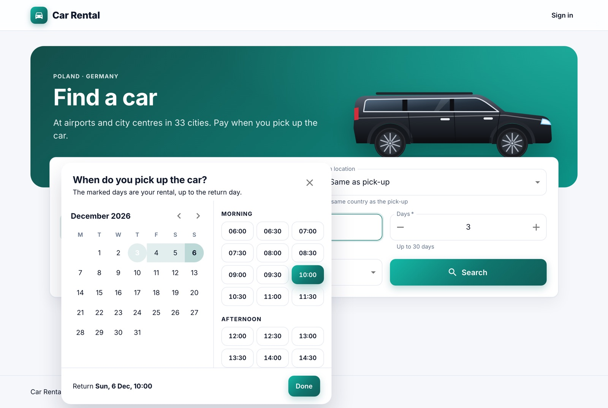
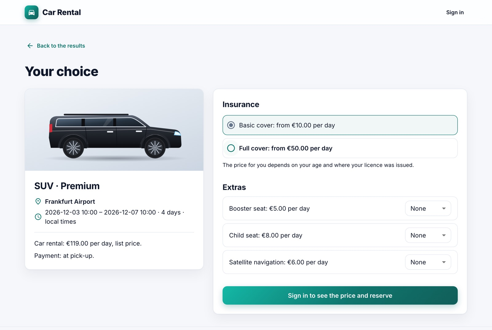
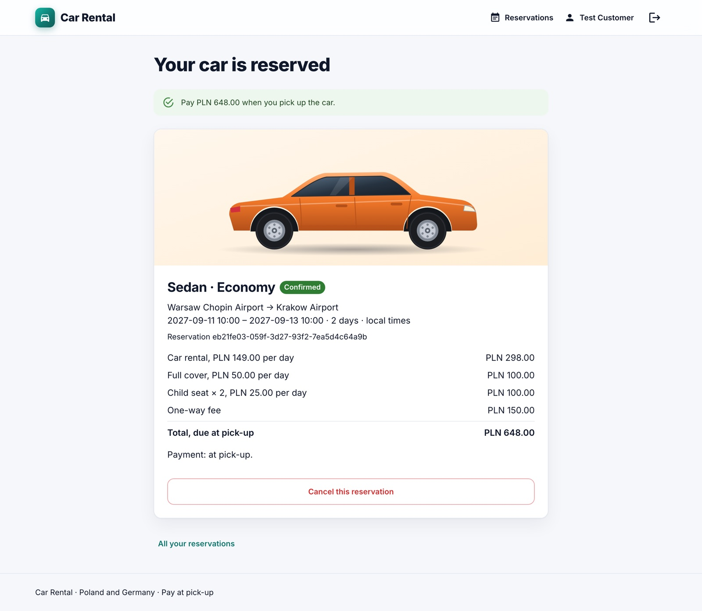
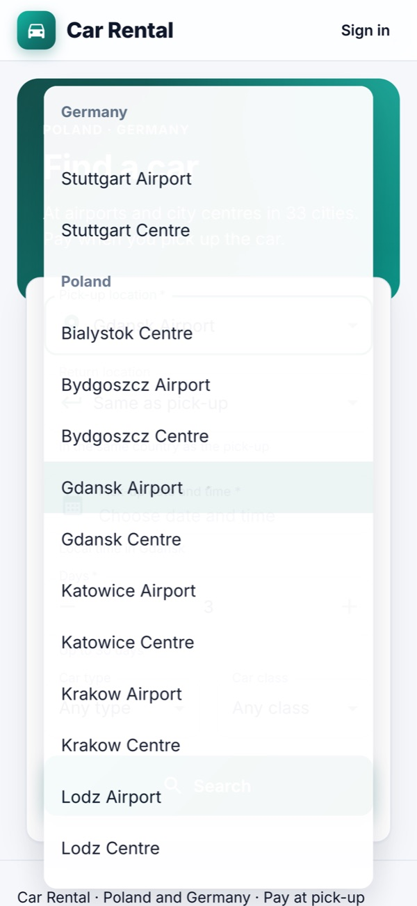
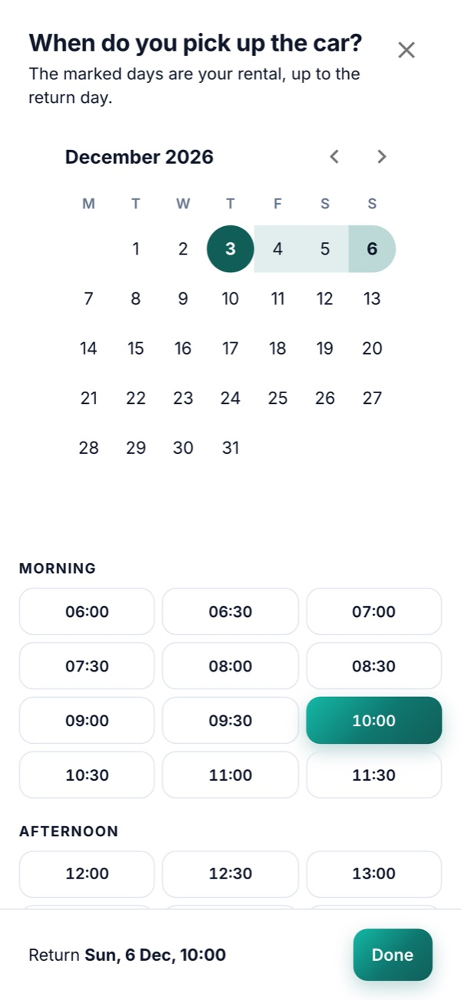
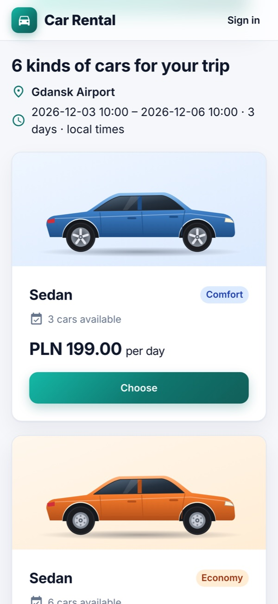
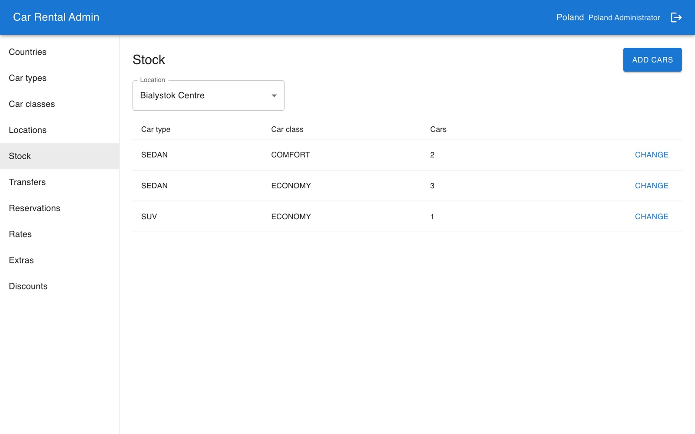
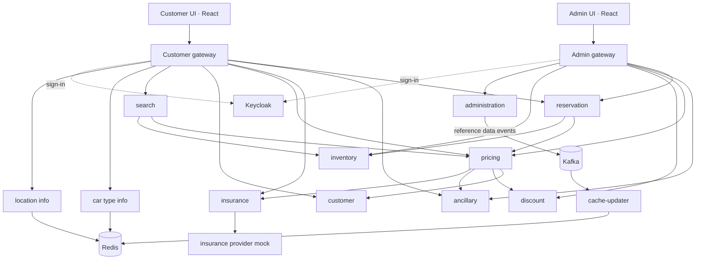

<div align="center">

# 🚗 Car Rental

**A car rental reservation system for Poland and Germany, built as microservices.**

Customers find a car at an airport or a city centre, choose insurance and extras, see the final
price and reserve it. Administrators run the stock, rates, discounts and pick-up desk of their
country.

[](https://github.com/siarhei-ka/car-rental/actions/workflows/backend.yml)
[](https://github.com/siarhei-ka/car-rental/actions/workflows/ui.yml)
[](https://github.com/siarhei-ka/car-rental/actions/workflows/e2e.yml)
[](https://github.com/siarhei-ka/car-rental/actions/workflows/images.yml)




</div>

---

## Contents

- [Highlights](#highlights)
- [Screenshots](#screenshots)
- [Architecture](#architecture)
- [Technology](#technology)
- [Quick start](#quick-start)
- [Test accounts](#test-accounts)
- [Open it from a phone, over HTTPS](#open-it-from-a-phone-over-https)
- [Development](#development)
- [Testing](#testing)
- [Repository layout](#repository-layout)
- [Where the assignment is proven](#where-the-assignment-is-proven)
- [Contributing](#contributing)
- [Documentation](#documentation)

## Highlights

- **Never overbooks.** One capacity rule, in one service, checked under a row lock. A reservation
  holds a car first and confirms it after; a hold that is never confirmed is released by itself. A
  test sends concurrent requests for the last car against a real database.
- **Countries as tenants.** Every per-country service keeps one PostgreSQL schema per country, and
  a country administrator sees and changes only their own country.
- **57 locations** with stock and rates: the major cities and the airports with regular flights in
  Poland (25) and Germany (32).
- **A price the customer can trust.** The final price lists every line: the rental, insurance priced
  for the driver's age and licence, extras, a one-way fee and the best discount. The car is reserved
  at exactly the price on screen; if it changed meanwhile, the customer confirms the new one.
- **Sign-in with Keycloak** through two gateways, one per UI, with sessions in Redis. Every service
  checks the token, its roles and its country; services call each other with tokens of their own.
- **Events through an outbox.** Reference data changes and analytics events reach Kafka from the
  same transaction as the change, so none is lost and none describes a change that did not happen.
- **A modern customer site** with a picture for every car type and class, a calendar that marks the
  days of the rental, and a layout made for phones too.
- **Tested end to end** in Chromium, Firefox and WebKit, on a desktop and a phone, plus a k6 load
  check.

## Screenshots

| Search results | Pick-up date and time |
|---|---|
|  |  |
| **Insurance and extras** | **A reservation with its price** |
|  |  |

<table>
  <tr>
    <th>Search on a phone</th>
    <th>The calendar on a phone</th>
    <th>Offers on a phone</th>
  </tr>
  <tr>
    <td></td>
    <td></td>
    <td></td>
  </tr>
</table>

**Admin UI:** the stock of a location, as the administrator of Poland sees it.



## Architecture



- **PostgreSQL** is the source of truth: one database per service, and one schema per country in
  each per-country service.
- **Kafka** carries reference data events and analytics events (searches, quotes, reservations and
  administrators' changes), written through an outbox.
- **Redis** is a read cache of reference data for the info services, and holds the gateways'
  sessions. Stock and reservations never use it.
- **Calls between services** are REST with a timeout of 2 seconds; a failed dependency gives a clear
  error, never a hanging request. Each per-country service learns the list of countries from the
  administration service.

| Service | What it does |
|---|---|
| `inventory-service` | Stock, holds and transfers. The only place of the capacity rule |
| `reservation-service` | Reservations at the price of the pricing service, and their life cycle |
| `administration-service` | Countries, car types, car classes and locations, with events on Kafka |
| `cache-updater` | Keeps the Redis copy of reference data up to date |
| `info-services/location`, `info-services/car-type` | Locations, car types and classes, read from Redis only |
| `search-service` | Finds the free car types and classes for a location and period |
| `customer-service` | The driver profile: date of birth and licence country |
| `pricing-service` | Daily rates and the final price |
| `ancillary-service` | Extras and the one-way fee |
| `insurance-service`, `insurance-provider-mock` | Insurance options, priced by a stand-in provider |
| `discount-service` | Discount rules and the best discount of a basket |
| `api-gateway` | The two gateways of the UIs: sign-in, sessions and routes |
| `shared` | Error format, correlation ID, token checks, the outbox and analytics events |

The full design, with the domain model, the reservation life cycle, pricing, identity, events and
the non-functional requirements, is in [docs/ARCHITECTURE.md](docs/ARCHITECTURE.md).

## Technology

| Area | Choice |
|---|---|
| Backend | Java 25, Spring Boot 4.1, Spring Cloud Gateway, `JdbcClient` with plain SQL, Flyway |
| Data | PostgreSQL 18, Redis, Kafka in KRaft mode |
| Identity | Keycloak 26: sign-in with PKCE for the UIs, client credentials between services |
| Frontends | React 19, TypeScript, Vite, React Router, TanStack Query, MUI, API types generated from OpenAPI |
| Tests | JUnit, Testcontainers, Vitest, React Testing Library, Playwright, k6 |
| Delivery | Docker Compose, one image per service, GitHub Actions |

## Quick start

Only Docker is needed.

```bash
cp .env.example .env
```

Set the passwords and secrets in `.env` (any long random values), then:

```bash
docker compose up --build
```

| Address | What |
|---|---|
| http://localhost:8080 | The customer UI |
| http://localhost:8090 | The admin UI |
| http://localhost:8180 | Keycloak's admin console (user `admin`, password `KEYCLOAK_ADMIN_PASSWORD`) |
| http://localhost:8087, http://localhost:8088 | The customer gateway and the admin gateway |

**Try it:** search from Warsaw Chopin Airport or Frankfurt Airport. Searching needs no sign-in, and
neither does choosing insurance and extras at list prices. To see the final price, sign in; on the
first sign-in the site asks for a driver profile: the date of birth and the country that issued the
driving licence. The price page shows every line, the discount and the total due at pick-up, and
reserves the car at that price. "Reservations" in the top bar lists the customer's reservations,
where an upcoming one can be cancelled. In the admin UI, "Reservations" registers pick-ups, returns
and no-shows, and a car type and class without a daily rate is not offered in the search.

> [!NOTE]
> If the database volume was created before Keycloak was added, Keycloak's database is missing.
> Recreate the volumes once with `docker compose down -v`, which also deletes the example data.

## Test accounts

All test users share the password `KEYCLOAK_TEST_USER_PASSWORD` from `.env`.

| User | UI | Can do |
|---|---|---|
| `customer` | Customer | Reserves and cancels. Stands in for a Google account |
| `super-admin` | Admin | Everything, in every country |
| `admin-pl` | Admin | The locations, stock, transfers, rates, extras, discounts and desk of Poland. Reads the shared reference data |
| `admin-de` | Admin | The same for Germany |

Customers sign in with Google once a Google application is set up, as described in
[infra/keycloak](infra/keycloak/README.md).

## Open it from a phone, over HTTPS

<details>
<summary><b>From a phone on the same Wi-Fi</b></summary>

Set `PUBLIC_HOST` in `.env` to this computer's address on the network (on a Mac,
`ipconfig getifaddr en0`), and run `docker compose up -d` again. The UIs are then on
`http://<PUBLIC_HOST>:8080` and `:8090`, and sign-in goes to Keycloak at
`http://<PUBLIC_HOST>:8180`; localhost keeps working on this computer.

A realm imported before keeps its old return addresses: add `http://<PUBLIC_HOST>:8080` and `:8090`
to the clients `customer-ui` and `admin-ui` in the Keycloak admin console, or start with a new
Keycloak database. The address must be set again when the network gives the computer a new one.

</details>

<details>
<summary><b>Over HTTPS</b></summary>

The profile `https` puts a proxy, Caddy, in front of the UIs and Keycloak. It serves a certificate
of a local certificate authority that this repository makes for you:

```bash
infra/https/make-certs.sh 192.168.0.41
```

Then set in `.env`, with your address:

```bash
PUBLIC_HOST=192.168.0.41
COMPOSE_PROFILES=https
KEYCLOAK_PUBLIC_URL=https://192.168.0.41:8543
CUSTOMER_UI_URL=https://192.168.0.41:8443
ADMIN_UI_URL=https://192.168.0.41:9443
```

and run `docker compose up -d --build`. The customer UI is then on `https://192.168.0.41:8443`, the
admin UI on `:9443` and Keycloak on `:8543`. The HTTP addresses keep working, and sign-in from them
goes to Keycloak over HTTPS too.

Each phone or computer that opens the system trusts the authority `infra/https/certs/ca.crt` once:

- **iPhone:** send the file to the phone (AirDrop or mail) and open it, install the profile under
  Settings → Profile Downloaded, then turn on full trust for "Car Rental local CA" under Settings →
  General → About → Certificate Trust Settings.
- **Android:** Settings → Security → Encryption & credentials → Install a certificate → CA
  certificate.
- **Mac:** open the file in Keychain Access and set it to "Always Trust".

`ca.key` never leaves this computer. A new network address needs only a new certificate: run the
script again with it, then restart `https-proxy`. The authority stays, so phones keep trusting it.
A realm imported before keeps its return addresses; add the HTTPS ones to the clients `customer-ui`
and `admin-ui` in the Keycloak admin console.

</details>

## Development

**Requirements:** JDK 25, and Docker for the integration tests and for running the system. Maven is
not required; the Maven Wrapper downloads it. Node 22 or later for the UIs and the e2e tests.

### Build and test the backend

```bash
./mvnw verify
```

This compiles the code, runs the unit and integration tests, checks line coverage (90% for each
domain, 80% for each service) and checks the formatting. The integration tests start PostgreSQL in
Docker through Testcontainers. To fix the formatting:

```bash
./mvnw spotless:apply
```

### Work on a UI with live reload

Start the system with Docker Compose, then run the UI's dev server, which passes the API and
sign-in on to the gateway:

```bash
cd ui && npm install && npm run dev
```

The car pictures of the customer UI are drawn by `ui/scripts/draw_cars.py`.

### Call the API

Only the UIs, the gateways and Keycloak can be reached from the development machine. Every service
accepts a call only with a valid access token of the realm, and checks its roles and country. The
customer gateway gives a visitor's calls a token of its own, so the public reads work without
signing in:

```bash
curl "http://localhost:8087/api/v1/locations?country=pl"
```

```bash
curl -H "X-Country: pl" "http://localhost:8087/api/v1/search?pickUpLocationId=waw-airport&start=2026-12-24T09:00:00Z&days=3"
```

<details>
<summary><b>Call a service directly while debugging</b></summary>

Publish the service ports and send a token. The ports are 8081 inventory, 8082 reservation, 8083
administration, 8084 location info, 8085 car type info, 8086 search, 8089 customer, 8091 pricing,
8092 ancillary, 8093 insurance, 8094 the insurance provider mock and 8095 discount, each with its
API described at `/openapi.yaml`, except the mock:

```bash
docker compose -f compose.yaml -f compose.ports.yaml up -d
```

A token of a service client, here the search service, after loading `.env` into the shell with
`set -a; . ./.env; set +a`:

```bash
TOKEN=$(curl -s -u "search-service:$SEARCH_SERVICE_CLIENT_SECRET" -d grant_type=client_credentials http://localhost:8180/realms/car-rental/protocol/openid-connect/token | jq -r .access_token)
```

```bash
curl -H "Authorization: Bearer $TOKEN" -H "X-Country: pl" "http://localhost:8081/api/v1/availability?locationId=waw-airport&start=2026-12-24T09:00:00Z&days=3"
```

</details>

## Testing

| Level | What | Where |
|---|---|---|
| Unit | Domain rules, without Spring or a database | `services/*/domain` |
| Integration | Each service with PostgreSQL in Testcontainers: its API, events and token checks | `services/*/app` |
| UI | Pages and components, with Vitest and React Testing Library | `ui`, `admin-ui` |
| End to end | Both UIs against the running system, on a desktop and a phone | `e2e` |
| Load | 20 requests per second for two minutes, at most 5% slower than 300 ms | `load` |

### End-to-end tests

The Playwright tests run against a started system and read the test users' password from `.env`.
CI runs them for every pull request.

```bash
cd e2e && npm install && npx playwright install chromium && npm test
```

`npm run test:all-browsers` also runs them in Firefox and in Safari's engine, on a desktop and an
iPhone, after `npx playwright install firefox webkit`. Over the local HTTPS proxy, set
`E2E_LOCAL_HTTPS=1`, so that their browsers accept the local authority.

### Load check

The k6 script sends 20 requests per second from up to 50 users for two minutes through the customer
UI's address, signed in as the test customer for the final prices, and fails if more than 5% of the
answers take longer than 300 ms:

```bash
docker run --rm -i --add-host=host.docker.internal:host-gateway --env-file .env grafana/k6:1.5.0 run - < load/load-test.js
```

### Continuous integration

| Workflow | Runs |
|---|---|
| Backend | `./mvnw verify`: tests, coverage and formatting |
| UI | For both UIs: that the API types match the OpenAPI descriptions, lint, formatting, types, tests and the build |
| Images | A Docker image of every service |
| End to end | The whole system in Docker Compose, then the Playwright tests |

## Repository layout

```
.
├── services/          The Spring Boot services; most have a domain and an app module
│   └── shared/        Error format, correlation ID, token checks, outbox, analytics events
├── ui/                The customer UI
├── admin-ui/          The admin UI
├── e2e/               Playwright tests
├── load/              The k6 load check
├── infra/
│   ├── keycloak/      The realm: clients, roles and test users
│   ├── postgres/      Databases and users of the services
│   └── https/         The optional HTTPS proxy and its certificate script
├── docs/              Architecture, project notes and screenshots
├── compose.yaml       The whole system
└── .env.example       Passwords and settings, to copy to .env
```

## Where the assignment is proven

The original assignment asks for a system that reserves a car of a given type at a date and time for
a number of days, with three car types and a limited number of cars of each type, proven by unit
tests.

- Each requirement maps to named tests in
  [AssignmentRequirementsTest](services/inventory-service/domain/src/test/java/psn/car/rental/inventory/domain/AssignmentRequirementsTest.java).
- That the limit also holds under concurrent requests, against a real database, is proven by
  [ConcurrencyTest](services/inventory-service/app/src/test/java/psn/car/rental/inventory/ConcurrencyTest.java).

## Contributing

`main` is protected: nobody pushes to it directly, the maintainer included. Every change arrives as
a pull request from a branch or a fork, needs the end-to-end check (`Playwright`) to pass on a
branch that is up to date with `main`, and needs every review conversation resolved. Pull requests
are squash-merged, so the history stays linear, and only the maintainer merges them. Workflows of
pull requests from forks run after the maintainer approves them.

Security problems are reported privately, as described in [SECURITY.md](SECURITY.md).

## Documentation

- [Architecture](docs/ARCHITECTURE.md): the design in force.
- [Project notes](docs/PROJECT_NOTES.md): the market analysis and the history of decisions.
- [Keycloak realm](infra/keycloak/README.md): clients, roles, test users and Google sign-in.
